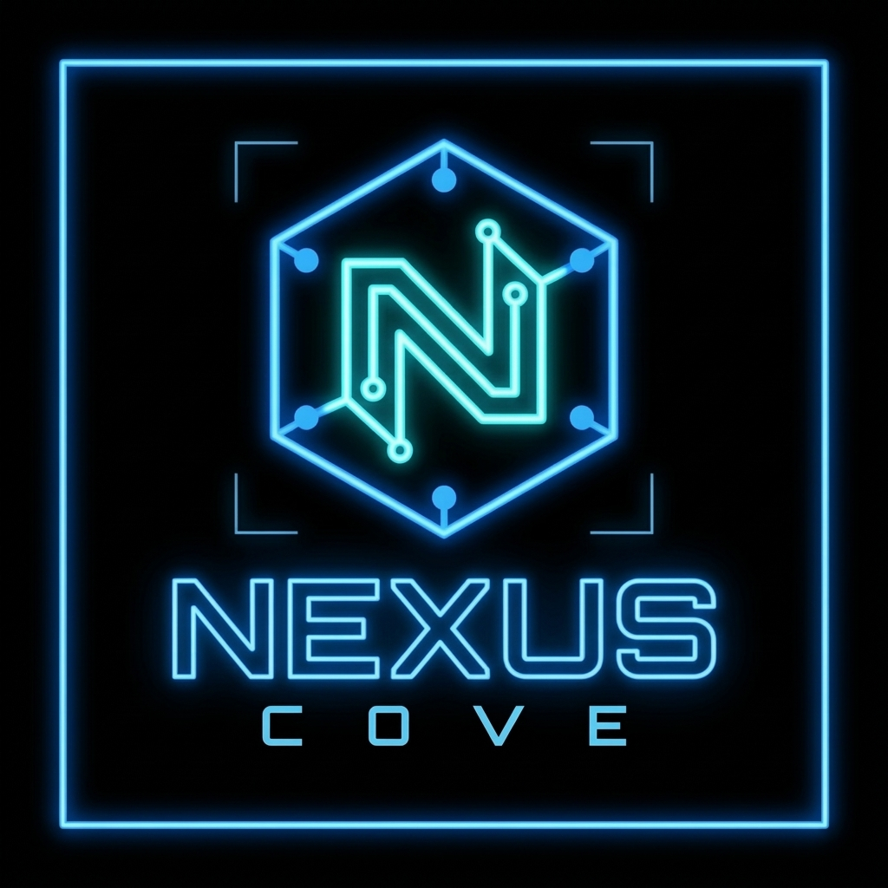

<p align="center">
  
</p>

<h1 align="center">NEXUS COVE</h1>

<p align="center">
  Local multi-agent orchestration framework with explicit task, transport, storage, and observability boundaries.
</p>

---

## Overview

NEXUS COVE runs a WebSocket server on your machine so that a manager, one or more workers, and browser clients can exchange structured messages. The manager submits tasks, the scheduler assigns them to capable workers, workers execute them through a backend, and results are stored in SQLite. A browser GUI provides live chat between named clients.

The server binds to `127.0.0.1` by default and has **no authentication or encryption**. Do not expose it to a network.

## What's New

- Aegis and Vigil use the locally installed Ollama model `qwen2.5:0.5b` for chat replies in the standard startup scripts. Human-to-agent replies remain immediate.
- Agent-to-agent direct messages are paced centrally: the next message is delivered no sooner than 20 seconds after the previous one. A message sent before then is rejected with a retry delay.
- The existing HTML chat interface is unchanged.
- COVE-MEM semantic/episodic memory framework under `src/nexus_cove/memory/` with JSONL and SQLite backends.

## Status

**Implemented and covered by tests**

- WebSocket server (protocol version 1) with named registration, broadcast, direct messages, and structured error replies for missing versions, unknown recipients, and duplicate names.
- Worker registration by agent ID with capabilities, task assignment, execution through the deterministic backend, and result return to the manager.
- SQLite persistence of tasks and results, and in-process metrics based on measured durations.
- Browser GUI (`web/index.html`) for registration, the roster, broadcasts, and direct messages.
- Optional Ollama-backed agent chat replies. The model is used for conversation, not assigned task execution.
- A global 20-second minimum between agent-to-agent direct-message deliveries, plus a per-partner reply limit.
- COVE-MEM memory framework: episodic and semantic memory, JSONL and SQLite backends, memory bridge, and configuration round-trip.

**Not implemented**

- Model-backed execution of assigned tasks. Workers use the deterministic development backend and do not turn chat messages into tasks automatically.
- Authentication, TLS, and access control.
- A production execution backend or deployment configuration.
- An open-source license. All rights are reserved.

Tests are the authoritative evidence for the status above. Run them to confirm it on your machine. **126 tests pass** across unit, integration, and e2e levels.

## Prerequisites

- **Python 3.11, 3.12, or 3.13** — Check with `python --version` or `python3 --version`
- **Git** — For cloning the repository
- **A browser** — To open `web/index.html`
- **Local TCP port 8765** — For the WebSocket server (binds to `127.0.0.1`)
- **Optional for model-generated chat replies:** [Ollama](https://ollama.com/download) installed and running locally. The standard agent launcher uses `qwen2.5:0.5b`; this model must be downloaded before agents can use it.

NEXUS COVE does not require Ollama for the server, browser chat, or deterministic task round-trip checks. Without `--model`, workers use fixed development replies. Do not expose the unauthenticated server beyond loopback.

### Platform-Specific Notes

| Platform | Notes |
|----------|-------|
| **Windows 10/11** | Use PowerShell for launcher scripts (see below) |
| **Ubuntu/Termux/Linux** | Use bash commands; all Python modules run natively on POSIX |
| **macOS** | Same as Ubuntu; use bash commands |

### Termux (Android) Specific

```bash
pkg install python git
# Optional for Ollama
pkg install ollama
```

## Get the source

```powershell
git clone https://github.com/thomasmixon2024/NEXUS-COVE.git
Set-Location .\NEXUS-COVE
```

If you received a project archive instead, extract it and open PowerShell in the extracted project root. The root is the directory containing `pyproject.toml`, `src/`, and `web/`.

## Install

Run these commands from the repository root.

### Windows (PowerShell)

```powershell
python --version
python -m venv .venv
.\.venv\Scripts\python.exe -m pip install --upgrade pip
.\.venv\Scripts\python.exe -m pip install -e ".[dev]"
```

The editable install provides the `cove-server`, `cove-manager`, and `cove-worker` commands. The runtime dependency is `websockets`; the `[dev]` extra also installs pytest, Ruff, coverage, and pre-commit tools.

For a runtime-only install, use `python -m pip install -e .` instead. To activate the environment in PowerShell for shorter commands, run:

```powershell
Set-ExecutionPolicy -Scope Process -ExecutionPolicy Bypass
.\.venv\Scripts\Activate.ps1
```

### Ubuntu / Termux / Linux / macOS (bash)

```bash
python3 --version
python3 -m venv .venv
source .venv/bin/activate
python -m pip install --upgrade pip
python -m pip install -e ".[dev]"
```

To activate the environment for subsequent commands:

```bash
source .venv/bin/activate
```

The PowerShell launchers and desktop-shortcut scripts are Windows-only. On POSIX, run components manually as described below.

## Start the full local test bed

This is the recommended Windows path for running the browser chat with the manager and both agents:

1. Install and start Ollama if you want model-generated agent replies. In PowerShell, check the service and download the configured model:

   ```powershell
   ollama --version
   ollama list
   ollama pull qwen2.5:0.5b
   ```

   Ollama should answer locally at `http://127.0.0.1:11434`. If `ollama list` does not show `qwen2.5:0.5b`, the agents cannot use it. Ollama is not required when you intentionally want fixed development replies.

2. From the repository root, launch the test bed:

   ```powershell
   Set-ExecutionPolicy -Scope Process -ExecutionPolicy Bypass
   .\.venv\Scripts\Activate.ps1
   powershell -NoProfile -ExecutionPolicy Bypass -File .\scripts\launchers\Launch-NexusTestBed.ps1
   ```

   Activate the environment first because the launcher starts children by resolving `python` from `PATH`. The launcher starts the WebSocket server if port `8765` is free, then starts a manager, Aegis-Worker, and Vigil-Worker as hidden processes. Both workers use `qwen2.5:0.5b`; Aegis starts a conversation with Vigil at five-minute intervals. The browser page opens at the end.

   The launcher reuses an existing server and skips workers when it finds a process with the same name. If you changed a worker's model or startup options, stop that worker first and then run the launcher again; otherwise it may reuse the old process.

3. In the browser, wait for **Connected**, register a human username, and use Nexus Chat for a group message or an agent row's **DM** control for a private message. Agent-to-agent direct messages are spaced at least 20 seconds apart; human-to-agent replies are not delayed by that limit.

To create a desktop shortcut for the full test bed, run:

```powershell
powershell -NoProfile -ExecutionPolicy Bypass -File .\scripts\launchers\Update-TestBedShortcut.ps1
```

The shortcut uses the project icon from `assets/NEXUS-COVE-LOGO.ico`. Before opening the browser, the launcher checks that Ollama and `qwen2.5:0.5b` are available and waits for the manager and both active workers to register.

Worker and server output is written under `logs/`: `server.out.log`, `manager.out.log`, `Aegis-Worker.out.log`, `Vigil-Worker.out.log`, and matching `.err.log` files. `launcher.log` records startup checks and failures.

### POSIX / Termux (manual component startup)

The PowerShell launchers are Windows-only. On POSIX, start each component in a separate terminal:

```bash
# Terminal 1: WebSocket server
source .venv/bin/activate
python -m nexus_cove.transport.websocket.server

# Terminal 2: Manager (with SQLite storage)
source .venv/bin/activate
python -m nexus_cove.orchestration.manager --db data/cove.db

# Terminal 3: Aegis-Worker
source .venv/bin/activate
python -m nexus_cove.agents.worker --name Aegis-Worker --test-backend --model qwen2.5:0.5b --start-conversation Vigil-Worker

# Terminal 4: Vigil-Worker
source .venv/bin/activate
python -m nexus_cove.agents.worker --name Vigil-Worker --capability analysis --test-backend --model qwen2.5:0.5b
```

Then open `web/index.html` in a browser. Omit `--model qwen2.5:0.5b` when Ollama is not installed; workers then use fixed development replies.

## Data and logs

- Manager task and result records use SQLite at `data/cove.db` by default; override the database path with the manager's `--db` option.
- The server appends delivered chat messages to `logs/nexus_chat.jsonl`.
- Workers append conversation memory to `data/memory/<agent>.jsonl`.
- Pause state is kept in `data/PAUSE` globally or `data/paused/<agent>.flag` per worker.
- `NEXUS_COVE_DATA_DIR` changes worker memory and pause-file locations. `NEXUS_COVE_LOG_DIR` changes the chat-log directory. Set each variable before starting the process that uses it.

### Server and browser only

To use the GUI with human clients but no agents, start only the server:

```powershell
.\.venv\Scripts\python.exe -m nexus_cove.transport.websocket.server
```

In another PowerShell window, open the page:

```powershell
Start-Process .\web\index.html
```

`Setup_NEXUS.ps1` is also a server-and-GUI setup helper: it creates a desktop shortcut, starts the server when the port is free, and opens the page. It does **not** start the manager or agent workers, and it expects the installed `cove-server` command to be on `PATH`.

### Start components manually

For visible consoles and easier troubleshooting, open a separate PowerShell window for each process. Run all commands from the repository root, after completing the install above.

Server:

```powershell
.\.venv\Scripts\python.exe -m nexus_cove.transport.websocket.server
```

Manager:

```powershell
.\.venv\Scripts\python.exe -m nexus_cove.orchestration.manager
```

Aegis and Vigil with Ollama replies:

```powershell
.\.venv\Scripts\python.exe -m nexus_cove.agents.worker --name Aegis-Worker --test-backend --model qwen2.5:0.5b --start-conversation Vigil-Worker
.\.venv\Scripts\python.exe -m nexus_cove.agents.worker --name Vigil-Worker --capability analysis --test-backend --model qwen2.5:0.5b
```

Omit `--model qwen2.5:0.5b` when Ollama is not installed; workers then use fixed development replies. Open `web/index.html` separately if a launcher did not open it.

Each identity can be registered only once. Do not start a second server, manager, or worker with the same identity while the first is still running.

## Verify installation

Run the test suite from the repository root:

### Windows (PowerShell)
```powershell
.\.venv\Scripts\python.exe -m pytest tests -q
```

### POSIX / Termux (bash)
```bash
source .venv/bin/activate
python -m pytest tests -q
```

To verify the manager-to-worker task route, use a server and two workers, but **do not** start the standalone manager. The check script connects as `Nexus-Manager`, submits one deterministic task, waits for a worker, and stores the result in a temporary SQLite database:

### Windows (PowerShell)
```powershell
# Start the server and both workers in separate windows first.
.\.venv\Scripts\python.exe scripts\diagnostics\check_roundtrip.py
```

### POSIX / Termux (bash)
```bash
source .venv/bin/activate
python scripts/diagnostics/check_roundtrip.py
```

The full test-bed launcher starts its own manager, so do not run `check_roundtrip.py` in that same session.

For development checks:

### Windows (PowerShell)
```powershell
.\.venv\Scripts\python.exe -m ruff check .
.\.venv\Scripts\python.exe -m compileall -q src tests
```

### POSIX / Termux (bash)
```bash
source .venv/bin/activate
python -m ruff check .
python -m compileall -q src tests
```

Or run the project's PowerShell test wrapper (Windows only):

```powershell
powershell -NoProfile -ExecutionPolicy Bypass -File .\scripts\maintenance\Run-PythonTests.ps1
```

For POSIX, use the `run_tests.sh` script:

```bash
bash run_tests.sh
```

### Test levels

Tests are organized by level:

- `tests/unit/`: isolated, deterministic behavior
- `tests/integration/`: SQLite and WebSocket boundaries
- `tests/e2e/`: manager, worker, and result workflows

## Local model and pause control

Workers started with `--model <name>` answer direct messages with a local model served by [Ollama](https://ollama.com). The model must be running on `127.0.0.1:11434`. Replies are generated only on your machine.

### Windows (PowerShell)
```powershell
ollama pull qwen2.5:0.5b
python -m nexus_cove.agents.worker --name Aegis-Worker --test-backend --model qwen2.5:0.5b
```

### POSIX / Termux (bash)
```bash
source .venv/bin/activate
ollama pull qwen2.5:0.5b
python -m nexus_cove.agents.worker --name Aegis-Worker --test-backend --model qwen2.5:0.5b
```

To stop every agent from replying, create the file `data/PAUSE` (POSIX) or `data\PAUSE` (Windows). Delete it to resume:

### Windows (PowerShell)
```powershell
New-Item -ItemType File -Force data\PAUSE      # pause
Remove-Item data\PAUSE                     # resume
```

### POSIX / Termux (bash)
```bash
touch data/PAUSE        # pause
rm data/PAUSE           # resume
```

Agent-to-agent direct messages are spaced at least 20 seconds apart globally. The dialogue guard also limits agent replies to 10 per partner every 5 minutes; messages from a human reset that per-partner reply limit.

## Session Continuity (Claude Code)

NEXUS COVE includes a session continuity system that preserves context across Claude Code sessions:

### SessionStart Hook (automatic)
Runs `python3 .claude/initialize_session.py` at the start of every Claude Code session. Output includes:
- Last checkpoint ID, timestamp, and source (auto/manual)
- Task description, accomplishments, and next steps
- Files touched in the previous session
- Git state comparison: `MATCHES`, `CHANGED`, `DIVERGED`, or `UNKNOWN`

### SessionEnd Hook (automatic)
Runs `.claude/memory/save_checkpoint.py --auto` when a session ends. Captures:
- Current git HEAD, branch, last commit, and changed files (excludes `.claude/memory/`)
- Carries forward the last manual task/next steps
- Skips if identical to previous auto-checkpoint

### Manual Checkpoints
```bash
# Save a manual checkpoint
cat > /tmp/my_checkpoint.json << 'EOF'
{"task_description": "implemented feature X", "accomplishments": ["did A", "did B"], "next_steps": ["test C"]}
EOF
python3 .claude/memory/save_checkpoint.py --file /tmp/my_checkpoint.json

# View checkpoint history
python3 -c "
import json
from pathlib import Path
for line in Path('.claude/memory/session_checkpoints.jsonl').read_text().splitlines():
    d = json.loads(line)
    print(f\"{d['checkpoint_id']} [{d['source']}] {d['task_description']}\")
"
```

Checkpoint files are stored in `.claude/memory/`:
- `current_checkpoint.json` — latest checkpoint
- `session_checkpoints.jsonl` — append-only journal

## Skills & Plugins System

NEXUS COVE includes a skills/plugins installer system at `NexusCove_Skills_Plugins_Installers_v3/`:

### Installer Scripts (run in order)
```bash
# 1. Required skills
./NexusCove_Skills_Plugins_Installers_v3/02_setup_required_skills.sh

# 2. Required plugin (superpowers)
./NexusCove_Skills_Plugins_Installers_v3/03_setup_required_plugins.sh

# 3. Optional skills (11 skills including project-local)
./NexusCove_Skills_Plugins_Installers_v3/04_setup_optional_skills.sh

# 4. Optional plugins (none defined by default)
./NexusCove_Skills_Plugins_Installers_v3/05_setup_optional_plugins.sh
```

### Installed Skills (Project-Local)
These skills are in `.claude/skills/` and managed by the installer:

| Skill | Description |
|-------|-------------|
| `project-context` | Load Nexus Cove project context: architecture, ADRs, commands, key files |
| `dataviz` | Design-system-agnostic data visualization (palette validator, mark specs) |
| `claude-api` | Claude API/SDK reference: models, pricing, streaming, tools, MCP, caching |
| `run` | Launch and drive the project app to verify changes |
| `security-review` | Security review checklist for pending changes |
| `plugin-authoring` | Create Claude Code mods: panes, status lines, toasts, slash commands, hooks |
| `init` | Initialize a new CLAUDE.md with codebase documentation |
| `keybindings-help` | Customize keyboard shortcuts in `~/.claude/keybindings.json` |
| `fewer-permission-prompts` | Reduce repeated permission prompts with narrow allow rules |
| `workflow-authoring` | Turn repeated multi-step tasks into reusable skills |
| `code-review` | Review code changes for correctness, safety, definition-of-done |
| `simplify` | Simplify recently changed code for reuse, clarity, efficiency |

### Superpowers Plugin
The `superpowers@claude-plugins-official` plugin provides 15 process skills:
`brainstorming`, `systematic-debugging`, `test-driven-development`, `writing-plans`, `executing-plans`, `verification-before-completion`, `subagent-driven-development`, `dispatching-parallel-agents`, `finishing-a-development-branch`, `receiving-code-review`, `requesting-code-review`, `using-git-worktrees`, `using-superpowers`, `diagnosing-superpowers`, `writing-skills`

### Using Skills in Claude Code
```bash
# In Claude Code, invoke a skill:
/project-context
/dataviz
/claude-api
# etc.
```

## Memory & Checkpoint System (Agent-Level)

Each agent maintains its own memory in `data/memory/<agent>.jsonl`:
- One JSONL line per message heard/replied
- Recent entries included in prompts for context
- Session checkpoints every 100 messages + on demand

### Agent Memory API
```python
from nexus_cove.agents.memory import AgentMemory
memory = AgentMemory(data_dir() / "memory" / "Aegis-Worker.jsonl")
memory.create_session_checkpoint()  # Manual checkpoint
memory.startup_flush_with_highlight_retention()  # Restore highlights
```

## Agent personalities and conversation starter

Each agent reads its personality from `src\nexus_cove\agents\personalities\<Name>.toml`. Edit the file and restart the test bed to change an agent's character. Aegis-Worker starts a conversation with Vigil-Worker every 5 minutes. Replies stay limited to 10 per partner every 5 minutes, and any message from you resets the limit.

## Pausing agents

In the chat page, use **Pause** or **Resume** next to an agent, or **Pause all** and **Resume all** above the roster. A paused agent ignores direct messages, group messages, and its conversation starter. It posts one status line when it is paused, and another when it resumes.

Pauses are stored as files in `data\paused\`, one per agent. The global `data\PAUSE` file still silences everyone.

Agents answer messages you post to Nexus Chat. They never answer each other's broadcasts, so they cannot start a loop there.

## Nexus Chat

**Nexus Chat** is the group channel in the chat page. Your messages there go to everyone, and agents answer them. Agent-to-agent messages also appear there, in a distinct style. The server keeps the last 200 agent messages, so a page opened later still shows recent conversations. Agents never receive these copies.

## Stopping the network

In the chat page, **Stop network** asks for confirmation, then shuts down the server, the manager, and every agent. The page does not reconnect afterwards. Start the test bed again to bring everything back. Only a human client can send this command.

When running components manually, press `Ctrl+C` in each component's terminal. Avoid broad process-kill commands if other NEXUS COVE sessions are running.

## Troubleshooting

- **Python reports a missing module:** confirm the virtual environment is active, then rerun `python -m pip install -e ".[dev]"` from the repository root.
- **Port 8765 is already in use:** another server may already be running. Reuse that server or stop the owning process before starting another; only one server should own the port.
- **An agent says its model is unavailable:** run `ollama list`, confirm `qwen2.5:0.5b` is installed, and confirm Ollama responds at `http://127.0.0.1:11434`. Check the worker's `.err.log` for details.
- **An agent is connected but does not reply:** check its roster status and use **Resume** if it is paused. Also check for `data/PAUSE` or `data/paused/<agent>.flag` when pause state was set outside the UI.
- **The launcher keeps an old model configuration:** stop the existing named worker before relaunching; the launcher skips workers it detects as already running.

## Agent memory and tools

Each agent keeps a memory log in `data\memory\<agent>.jsonl`: one line for every message it heard and every reply it sent. The most recent entries go into each prompt, so an agent can refer back to earlier conversation. Entries are never edited.

Two tools exist, and each agent has only the one it asked for:

- **Aegis-Worker: Geology Analyzer.** Reports rows from `reference\geology.csv` for any material named in a message. The file starts with no entries, so the tool stays silent until you add real, cited values. See `reference\README.md`.
- **Vigil-Worker: Pattern Finder.** When a message asks about patterns, counts repeated words and questions across the messages Vigil has heard.

Tools run from the message text, not from the model's choice, so they work with small models.

## Per-agent knowledge

Each agent holds its own documents in `data\knowledge\<agent>\`. No agent can read another's folder. Give a document with the grant script, one agent at a time:

```powershell
python scripts\diagnostics\grant_knowledge.py Aegis-Worker notes.md
python scripts\diagnostics\grant_knowledge.py Vigil-Worker --list
```

An agent shares an item only by writing `SHARE: <title>` in a direct-message reply. The line is hidden and the item is sent to the other agent. Nothing is shared without that line, and shares never appear in Nexus Chat.

## Chat log

Every message in Nexus Chat, including direct messages, is written once to `logs\nexus_chat.jsonl` as it happens. The file is always current.

To save a copy as a document, click **Save chat log** in the chat page. If you try to close the page while there are unsaved messages, the browser asks whether to leave. Choose **Cancel**, then click **Save chat log**. Browsers show their own wording for that question, and they don't allow a file to download automatically on close.

## Speech

The **Speaker** button under the Nexus Chat heading turns on spoken agent messages. Each agent has its own voice, and only agent messages are read aloud; yours are not. The page prefers Microsoft Edge's Natural voices, which sound much more natural. Open the chat page in Microsoft Edge, turn the speaker on, and the page lists the voice each agent uses. Natural voices need an internet connection. If none is found, the agents use a basic voice, and pitch and speed keep them distinct. Chrome does not offer Edge's Natural voices.

Each sentence is spoken with its own expression. Questions rise, exclamations are brighter and quicker, and worried or uncertain wording slows and softens the voice. The browser can only change pitch, speed, and volume, so this is an approximation, not a real emotional performance.

## Protocol

Every message is a JSON object with `"version": 1` and an `action` field. Messages without a supported version receive an `error` action.

| Action | Direction | Purpose |
| --- | --- | --- |
| `register` | client to server | Claim a name (browsers) or an agent ID with capabilities (agents) |
| `broadcast` | client to server, then to all | Message every connected client |
| `direct_message` | client to server, then to recipient | Message one client |
| `task_assign` | manager to server, then to worker | Assign a task to a worker |
| `task_result` | worker to server, then to manager | Return a result |
| `ping` | client to server | Liveness check, answered with `pong` |
| `control` | human client to server, then to agents | Pause or resume one agent or all agents; `stop` shuts the network down |
| `agent_feed` | server to browser clients only | Agent-to-agent traffic, shown in Nexus Chat |

## Repository layout

```
assets/                     logo and other images
config/                     reserved for future external configuration
docs/                       architecture, decisions, operations, audit, history
scripts/
  diagnostics/              manual checks (round trip, connection check)
  launchers/                helper launchers for local testing
  maintenance/              test runner
src/nexus_cove/
  core/                     domain models, protocol, exceptions (no I/O)
  orchestration/            manager, scheduler, registries
  agents/                   worker lifecycle and execution backends
  memory/                   COVE-MEM semantic/episodic memory framework
  transport/websocket/      WebSocket server and connection handling
  storage/                  persistence interface and SQLite implementation
  observability/            structured logging and runtime metrics
tests/                      unit, integration, and end-to-end tests
web/index.html              browser GUI
```

Dependency direction is inward: transport and storage depend on `core`, and `core` imports neither.

## Documentation

- [Architecture overview](docs/architecture/overview.md)
- [Development guide](docs/operations/development.md)
- [Local development and security notes](docs/operations/local-development.md)
- [Architecture decisions](docs/decisions/)
- [Roadmap](docs/roadmap/phase-3.md)
- [Contributor and engineering protocol](CLAUDE.md)
- [Agent guidelines](AGENTS.md)

## Contributing

Read [CLAUDE.md](CLAUDE.md) and [AGENTS.md](AGENTS.md) first. They define the layering rules, testing policy, and definition of done. Changes should include tests, pass `python -m ruff check .` and `python -m compileall -q src tests`, and keep the documentation accurate.

## License

All rights are reserved. See [LICENSE](LICENSE) for the full statement. No open-source license has been granted; the Software may not be copied, modified, or redistributed without prior written permission from the copyright holders.