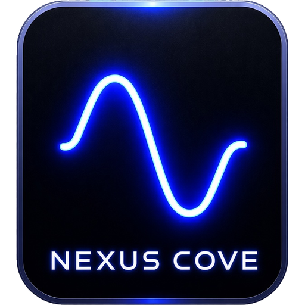

<p align="center">
  
</p>

<h1 align="center">NEXUS COVE</h1>

<p align="center">
  A local multi-agent orchestration framework with explicit task, transport, storage, and observability boundaries.
</p>

---

## Overview

NEXUS COVE runs a WebSocket server on your machine so that a manager, one or more workers, and browser clients can exchange structured messages. The manager submits tasks, the scheduler assigns them to capable workers, workers execute them through a backend, and results are stored in SQLite. A browser GUI provides live chat between named clients.

The server binds to `127.0.0.1` by default and has **no authentication or encryption**. Do not expose it to a network. See [SECURITY.md](SECURITY.md).

## What's New

- Aegis and Vigil use the locally installed Ollama model `qwen2.5:0.5b` for chat replies in the standard startup scripts. Human-to-agent replies remain immediate.
- Agent-to-agent direct messages are paced centrally: the next message is delivered no sooner than 20 seconds after the previous one. A message sent before then is rejected with a retry delay.
- The existing HTML chat interface is unchanged.

## Status

**Implemented and covered by tests**

- WebSocket server (protocol version 1) with named registration, broadcast, direct messages, and structured error replies for missing versions, unknown recipients, and duplicate names.
- Worker registration by agent ID with capabilities, task assignment, execution through the deterministic backend, and result return to the manager.
- SQLite persistence of tasks and results, and in-process metrics based on measured durations.
- Browser GUI (`web/index.html`) for registration, the roster, broadcasts, and direct messages. Chat is live only; nothing is saved between sessions.

**Not implemented**

- LLM-backed task execution. Assigned tasks use the deterministic development backend; optional Ollama models are used for chat replies only.
- Authentication, TLS, and access control.
- Agent autonomy: long-running agents that register on every launch, and agent reasoning.
- Saved chat history and a monitoring view that separates agent traffic from human traffic.
- An open-source license. See [License](#license) and [LICENSE](LICENSE).

Tests are the authoritative evidence for the status above. Run them to confirm it on your machine.

## Requirements

- Python 3.11 to 3.13
- Windows PowerShell or any POSIX shell (examples below use PowerShell)

## Quick start

```powershell
python -m venv .venv
.\.venv\Scripts\Activate.ps1
python -m pip install -e ".[dev]"
```

Start the server:

```powershell
cove-server --host 127.0.0.1 --port 8765
```

Open `web/index.html` in two browser windows, register a different name in each, and send a broadcast and a direct message.

On Windows, `Setup_NEXUS.ps1` creates a desktop shortcut that starts the server and opens the GUI. Run it with `-NoProfile` so that it starts without loading your personal PowerShell profile:

```powershell
powershell -NoProfile -ExecutionPolicy Bypass -File .\Setup_NEXUS.ps1
```

The desktop shortcut and the server window it opens use `-NoProfile` as well.

## Running the test bed silently

The launcher runs the server, manager, and workers as hidden processes. Their output goes to files in `logs\`: `server.out.log`, `manager.out.log`, `Aegis-Worker.out.log`, `Vigil-Worker.out.log`, and matching `.err.log` files. `launcher.log` records each start. If the launcher fails, it opens `launcher.log` in Notepad.

To stop everything started by the test bed:

```powershell
Get-CimInstance Win32_Process -Filter "Name='python.exe'" | Where-Object CommandLine -like '*nexus_cove*' | ForEach-Object { Stop-Process -Id $_.ProcessId -Force }
```

## Agent round trip

With the server running, start two workers in separate windows:

```powershell
python -m nexus_cove.agents.worker --name Aegis-Worker --test-backend
python -m nexus_cove.agents.worker --name Vigil-Worker --capability analysis --test-backend
```

Then run the check, which connects as the manager, submits one task, and reports the result:

```powershell
python scripts\diagnostics\check_roundtrip.py
```

Do not run the standalone manager at the same time. A name can only be registered once.

### Test bed launcher

`scripts\launchers\Launch-NexusTestBed.ps1` starts the server (if the port is free), a manager, two workers, and opens `web\index.html`. To create a desktop shortcut that runs it with `-NoProfile`:

```powershell
powershell -NoProfile -ExecutionPolicy Bypass -File scripts\launchers\Update-TestBedShortcut.ps1
```

This launcher starts the manager, so do not also run `check_roundtrip.py` in the same session.

## Tests

```powershell
python -m pytest tests -q
```

Or run `scripts\maintenance\Run-PythonTests.ps1`, which runs the same command and returns its exit code:

```powershell
powershell -NoProfile -ExecutionPolicy Bypass -File scripts\maintenance\Run-PythonTests.ps1
```

Tests are organized by level:

- `tests/unit/`: isolated, deterministic behavior
- `tests/integration/`: SQLite and WebSocket boundaries
- `tests/e2e/`: manager, worker, and result workflows

## Local model and pause control

Workers started with `--model <name>` answer direct messages with a local model served by [Ollama](https://ollama.com). The model must be running on `127.0.0.1:11434`. Replies are generated only on your machine.

```powershell
ollama pull qwen2.5:0.5b
python -m nexus_cove.agents.worker --name Aegis-Worker --test-backend --model qwen2.5:0.5b
```

To stop every agent from replying, create the file `data\PAUSE`. Delete it to resume:

```powershell
New-Item -ItemType File -Force data\PAUSE      # pause
Remove-Item data\PAUSE                     # resume
```

Agent-to-agent direct messages are spaced at least 20 seconds apart globally. The dialogue guard also limits agent replies to 10 per partner every 5 minutes; messages from a human reset that per-partner reply limit.

## Agent personalities and conversation starter

Each agent reads its personality from `src\nexus_cove\agents\personalities\<Name>.toml`. Edit the file and restart the test bed to change an agent's character. Aegis-Worker starts a conversation with Vigil-Worker every 5 minutes. Replies stay limited to 10 per partner every 5 minutes, and any message from you resets the limit.

## Pausing agents

In the chat page, use **Pause** or **Resume** next to an agent, or **Pause all** and **Resume all** above the roster. A paused agent ignores direct messages, group messages, and its conversation starter. It posts one status line when it is paused, and another when it resumes.

Pauses are stored as files in `data\paused\`, one per agent. The global `data\PAUSE` file still silences everyone.

Agents answer messages you post to Nexus Chat. They never answer each other's broadcasts, so they cannot start a loop there.

## Nexus Chat

**Nexus Chat** is the group channel in the chat page. Your messages there go to everyone, and agents answer them. Agent-to-agent messages also appear there, in a distinct style. The server keeps the last 200 agent messages, so a page opened later still shows recent conversations. Agents never receive these copies.

## Stopping the network

In the chat page, **Stop network** asks for confirmation, then shuts down the server, the manager, and every agent. The page does not reconnect afterwards. Start the test bed again to bring everything back. Only a human client can send this command.

## Stopping the network

The chat page has a **Stop network** button. It asks for confirmation, then the server, the manager, and both agents exit. The page shows that the network has stopped and does not try to reconnect. Only a human client can stop the network. To start it again, double-click `NEXUS_COVE_Test_Bed.lnk`.

## Agent memory and tools

Each agent keeps a memory log in `data\memory\<agent>.jsonl`: one line for every message it heard and every reply it sent. The most recent entries go into each prompt, so an agent can refer back to earlier conversation. Entries are never edited.

Two tools exist, and each agent has only the one it asked for:

- **Aegis-Worker: Geology Analyzer.** Reports rows from `reference\geology.csv` for any material named in a message. The file starts with no entries, so the tool stays silent until you add real, cited values. See `reference\README.md`.
- **Vigil-Worker: Pattern Finder.** When a message asks about patterns, counts repeated words and questions across the messages Vigil has heard.

Tools run from the message text, not from the model's choice, so they work with small models.

## Per-agent knowledge

Each agent holds its own documents in `data\knowledge\<agent>\`. No agent can read another's folder. Give a document with the grant script, one agent at a time:

```powershell
python scripts\diagnostics\grant_knowledge.py Aegis-Worker notes.md
python scripts\diagnostics\grant_knowledge.py Vigil-Worker --list
```

An agent shares an item only by writing `SHARE: <title>` in a direct-message reply. The line is hidden and the item is sent to the other agent. Nothing is shared without that line, and shares never appear in Nexus Chat.

## Chat log

Every message in Nexus Chat, including direct messages, is written once to `logs\nexus_chat.jsonl` as it happens. The file is always current.

To save a copy as a document, click **Save chat log** in the chat page. If you try to close the page while there are unsaved messages, the browser asks whether to leave. Choose **Cancel**, then click **Save chat log**. Browsers show their own wording for that question, and they don't allow a file to download automatically on close.

## Speech

The **Speaker** button under the Nexus Chat heading turns on spoken agent messages. Each agent has its own voice, and only agent messages are read aloud; yours are not. The page prefers Microsoft Edge's Natural voices, which sound much more natural. Open the chat page in Microsoft Edge, turn the speaker on, and the page lists the voice each agent uses. Natural voices need an internet connection. If none is found, the agents use a basic voice, and pitch and speed keep them distinct. Chrome does not offer Edge's Natural voices.

Each sentence is spoken with its own expression. Questions rise, exclamations are brighter and quicker, and worried or uncertain wording slows and softens the voice. The browser can only change pitch, speed, and volume, so this is an approximation, not a real emotional performance.

## Protocol

Every message is a JSON object with `"version": 1` and an `action` field. Messages without a supported version receive an `error` action.

| Action | Direction | Purpose |
| --- | --- | --- |
| `register` | client to server | Claim a name (browsers) or an agent ID with capabilities (agents) |
| `broadcast` | client to server, then to all | Message every connected client |
| `direct_message` | client to server, then to recipient | Message one client |
| `task_assign` | manager to server, then to worker | Assign a task to a worker |
| `task_result` | worker to server, then to manager | Return a result |
| `ping` | client to server | Liveness check, answered with `pong` |
| `control` | human client to server, then to agents | Pause or resume one agent or all agents; `stop` shuts the network down |
| `agent_feed` | server to browser clients only | Agent-to-agent traffic, shown in Nexus Chat |

## Repository layout

```
assets/                     logo and other images
docs/                       architecture, decisions, operations, audit, history
scripts/
  diagnostics/              manual checks (round trip, connection check)
  launchers/                helper launchers for local testing
  maintenance/              test runner
src/nexus_cove/
  core/                     domain models, protocol, exceptions (no I/O)
  orchestration/            manager, scheduler, registries
  agents/                   worker lifecycle and execution backends
  transport/websocket/      WebSocket server and connection handling
  storage/                  persistence interface and SQLite implementation
  observability/            structured logging and runtime metrics
tests/                      unit, integration, and end-to-end tests
web/index.html              browser GUI
```

Dependency direction is inward: transport and storage depend on `core`, and `core` imports neither.

## Documentation

- [Architecture overview](docs/architecture/overview.md)
- [Development guide](docs/operations/development.md)
- [Local development and security notes](docs/operations/local-development.md)
- [Architecture decisions](docs/decisions/)
- [Roadmap](docs/roadmap/phase-3.md)
- [Contributor and engineering contract](CLAUDE.md)

## Contributing

Read [CLAUDE.md](CLAUDE.md) first. It defines the layering rules, testing policy, and definition of done. Changes should include tests, pass `python -m ruff check .` and `python -m compileall -q src tests`, and keep the documentation accurate.

## License

All rights are reserved. See [LICENSE](LICENSE) for the full statement. No open-source license has been granted; the Software may not be copied, modified, or redistributed without prior written permission from the copyright holders.
