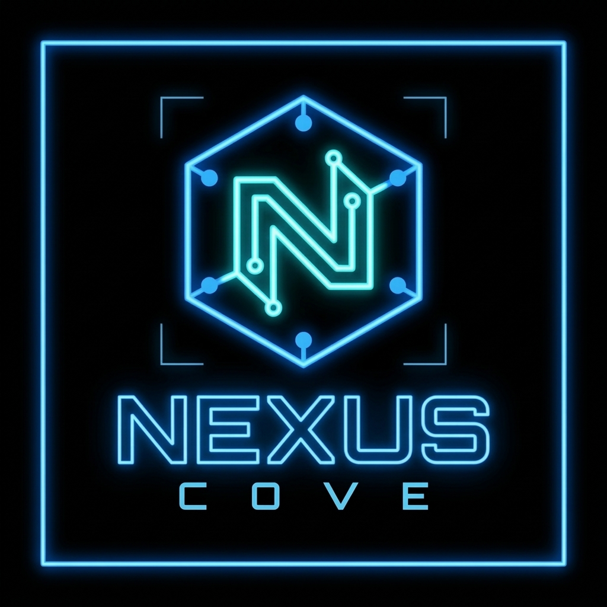

<div align="center">
  

  <h1>NEXUS-COVE</h1>

  <p><strong>A lightweight, async Python framework for running local AI agents.</strong><br>
  <em>Zero cloud. Zero API keys. Absolute edge.</em></p>

  [](https://www.python.org/downloads/)
  [](https://ollama.com)
  [](https://termux.dev)
  [](https://opensource.org/licenses/MIT)
</div>

---

## 🧠 What is this?

**NEXUS-COVE** is an asynchronous agent framework designed to be absurdly lightweight. It strips out the bloat of modern AI wrappers and gets straight to the point: connecting your agents to local, offline LLMs so they can talk to each other without paying a dime to OpenAI.

Built for the edge. Built for speed. Built to run anywhere Python runs.

---

## 🔥 THE TERMUX FLEX 🔥

We didn't just build this for 64-core server racks. We built it to run in your pocket.

> **Benchmark:** Tested live on an **Android ARM64 device via Termux**.
> **Model:** `qwen2.5:0.5b` (Q4_K_M)
> **Latency:** **1.57 seconds** (Warm) ⚡

If it runs on Android, it'll run on your toaster.

---

## ⚡ Core Features

* **True Async:** Built from the ground up with `asyncio` and `aiohttp` for non-blocking agent chatter.
* **Backend Agnostic:** Ships with native support for Ollama.
* **No API Keys:** Your data stays on your machine. Period.
* **Modular:** Want to add a new LLM backend? Drop it in `src/nexus_cove/agents/backends/`.
* **Python 3.14 Ready:** Constraint tested and verified up to `<3.15`.

---

## 🚀 Quick Start (The 10-Second Setup)

**Don't worry, you don't need to be a DevOps wizard to try this.** We built a one-click script that does *everything* for you (starts Ollama, pulls the model, installs dependencies, and runs the test).

🔗 **Repository:** [github.com/thomasmixon2024/NEXUS-COVE](https://github.com/thomasmixon2024/NEXUS-COVE)

[](https://github.com/thomasmixon2024/NEXUS-COVE)

```bash
git clone https://github.com/thomasmixon2024/NEXUS-COVE.git
cd NEXUS-COVE
./run_demo.sh
```

**Expected Output:**

```text
🚀 Initializing NEXUS-COVE...
⏳ Starting Ollama in the background...
📥 Ensuring qwen2.5:0.5b model is downloaded...
📦 Installing Python dependencies...
🧠 Running the verification test...
✅ Ollama reachable
Warming up model...
✅ PASS — measured latency: 1.57s
   Reply: "Hello! You're testing Termux..."
```

📖 **[Full Demo Installation Guide](docs/guides/demo-installation-guide.md)** — comprehensive walkthrough with all flags, error recovery, troubleshooting, and pro tips.

### 🎮 Interactive Installer (New in v2.0)

The `run_demo.sh` script now features an interactive TUI (Terminal User Interface) with error recovery:

```bash
# Interactive mode (default on TTY)
./run_demo.sh

# Automated with safe defaults (retry once, skip optional deps)
./run_demo.sh --yes

# CI / non-interactive mode (fail fast with log path)
./run_demo.sh --non-interactive

# Custom model
./run_demo.sh --model llama3.2

# Custom virtual environment
./run_demo.sh --venv /path/to/venv

# Skip Python dependencies (if already installed)
./run_demo.sh --skip-python-deps
```

**Correct launch (avoid the malformed `cd NEXUS-COVE ./run_demo.sh ...` pattern):**
```bash
cd NEXUS-COVE && ./run_demo.sh
# or
./run_demo.sh
```

### 📋 Command-Line Options

| Flag | Description |
|------|-------------|
| `-y`, `--yes` | Accept safe defaults, retry once, auto-skip optional deps, never install system packages |
| `--non-interactive` | Force non-interactive mode (fail fast on errors) |
| `--verbose` | Verbose output |
| `--log-dir <path>` | Log directory (default: `./logs/`) |
| `--skip-python-deps` | Skip Python dependency installation |
| `--with-dev` | Install dev extras (pytest, ruff, etc.) |
| `--no-dev` | Explicitly skip dev extras |
| `--venv <path>` | Virtual environment path (default: `.venv-termux` or `.venv`) |
| `--model <name>` | Ollama model (default: `qwen2.5:0.5b`) |
| `-h`, `--help` | Show help |

### 🎯 Interactive Error Recovery

When a step fails on a TTY, you'll see an actionable menu:

```
❌ Step failed: install_python_deps (exit 50)
📄 Log: logs/python-deps-20261020-143022.log

Options:
1. View full error log
2. Retry step
3. Install missing build prerequisites
4. Use prebuilt wheels only (--only-binary=:all:)
5. Skip optional dependencies and continue degraded
6. Abort
```

The script auto-detects failure patterns and suggests targeted fixes:
- **Rust/cargo/maturin errors** → Suggests `curl --proto '=https' --tlsv1.2 -sSf https://sh.rustup.rs | sh`
- **Python.h missing** → Suggests `apt install python3-dev` (or distro equivalent)
- **gcc/cc/make missing** → Suggests `apt install build-essential` (or distro equivalent)
- **Network errors** → Suggests retry
- **pyproject.toml metadata failures** → Suggests wheel-only install

### 📁 Log Locations

All logs are written to `./logs/` (project-relative):
- `prerequisites-YYYYMMDD-HHMMSS.log`
- `ollama-YYYYMMDD-HHMMSS.log`
- `model-pull-YYYYMMDD-HHMMSS.log`
- `venv-YYYYMMDD-HHMMSS.log`
- `python-deps-YYYYMMDD-HHMMSS.log`
- `demo-YYYYMMDD-HHMMSS.log`

### ⚡ Idempotency

Re-running `./run_demo.sh` is safe:
- Reuses existing virtual environment (`.venv-termux` or `.venv`)
- Skips re-pulling already-present Ollama model
- Does not restart a healthy Ollama daemon

### 🏗️ Architecture: TUI-First, Web-UI-Second

NEXUS-COVE adopts a **TUI-first architecture**:
- The interactive installer/monitor (`run_demo.sh`) is the primary control surface for installation, diagnostics, service status, log viewing, and error recovery
- A web UI is optional and secondary — once Ollama and the model are running, you may launch a lightweight web chat UI if configured
- The TUI remains fully functional even if a web UI fails to start
- No Termux/Ubuntu hybrid or proot-distro container is required

### ❌ Exit Codes

| Code | Meaning |
|------|---------|
| 10 | Prerequisite failure |
| 20 | Ollama failure |
| 30 | Model download failure |
| 40 | Virtual environment failure |
| 50 | Dependency installation failure |
| 60 | Demo runtime failure |
| 64 | Bad CLI usage (sysexits.h) |

### 🔧 Common Failure Fixes

| Error | Fix |
|-------|-----|
| `cargo`, `rustc`, `maturin` not found | Install Rust: `curl --proto '=https' --tlsv1.2 -sSf https://sh.rustup.rs \| sh` |
| `Python.h: No such file or directory` | Install Python headers: `apt install python3-dev` |
| `gcc: command not found` / `make: command not found` | Install build tools: `apt install build-essential` |
| `pip` metadata / `pyproject.toml` failure | Use `--only-binary=:all:` (option 4 in menu) or retry |
| Network timeout during install | Check connectivity, then retry (option 2 in menu) |
| Dev extras (pytest, ruff) fail | Choose "Skip optional dependencies" (option 5) |

### 🛠️ Manual Installation (Alternative)

If you prefer manual setup:

<details>
<summary><b>🛠️ Prefer to do it manually? Click here to expand.</b></summary>

<br>

**1. Prerequisites**

You need [Ollama](https://ollama.com/) installed and running on your host machine.

```bash
# Start the Ollama daemon
ollama serve

# Pull the lightweight test model
ollama pull qwen2.5:0.5b
```

**2. Install NEXUS-COVE**

Clone the repo and install it in editable mode:

```bash
git clone https://github.com/thomasmixon2024/NEXUS-COVE.git
cd NEXUS-COVE
pip install -e ".[dev]"
```

**3. Run the Verification Test**

```bash
python tests/termux_ollama_test.py
```

</details>

---

## 📱 Mobile / Termux Setup

Want to run it on Android? We wrote the whole playbook for it.

👉 [Read the Termux + Ollama Setup Guide](docs/operations/termux-ollama.md)

---

## 📂 Project Structure

```text
NEXUS-COVE/
├── docs/operations/       # Deployment guides (Termux, etc.)
├── src/nexus_cove/        # Core framework
│   └── agents/backends/   # LLM integrations (Ollama)
├── tests/                 # Pytest suite & standalone scripts
├── run_demo.sh            # One-click verification script
└── pyproject.toml         # PEP 621 packaging
```

---

## 🤝 Contributing

Got a new backend? Found a bug? PRs are wide open. Just make sure your tests pass and your code is formatted.

## 📝 License

Distributed under the MIT License. See [LICENSE](LICENSE) for more information.

---

<div align="center">
  <i>Built with ☕ and ⚡ by Thomas Mixon</i>
</div>
